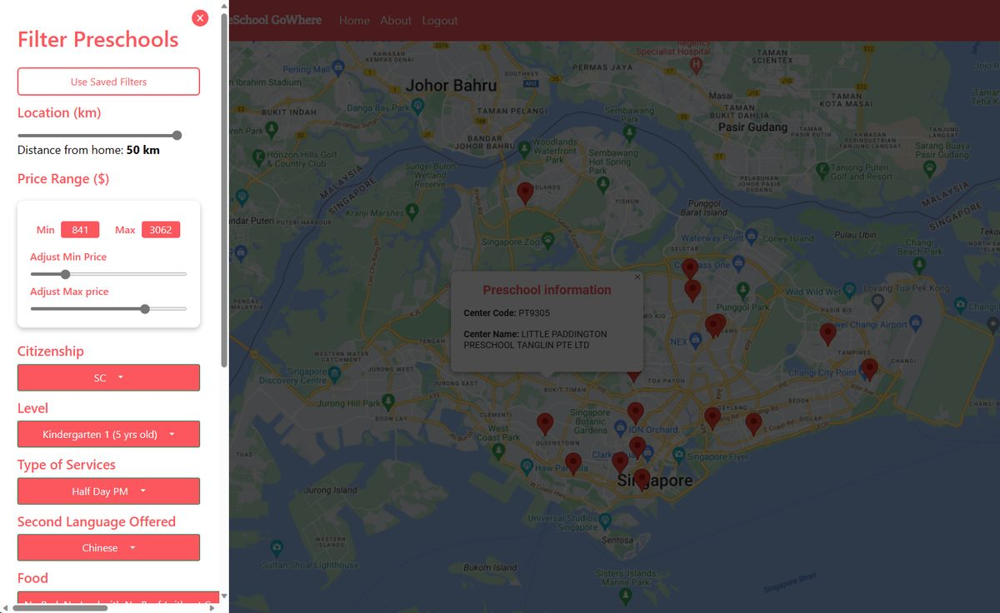
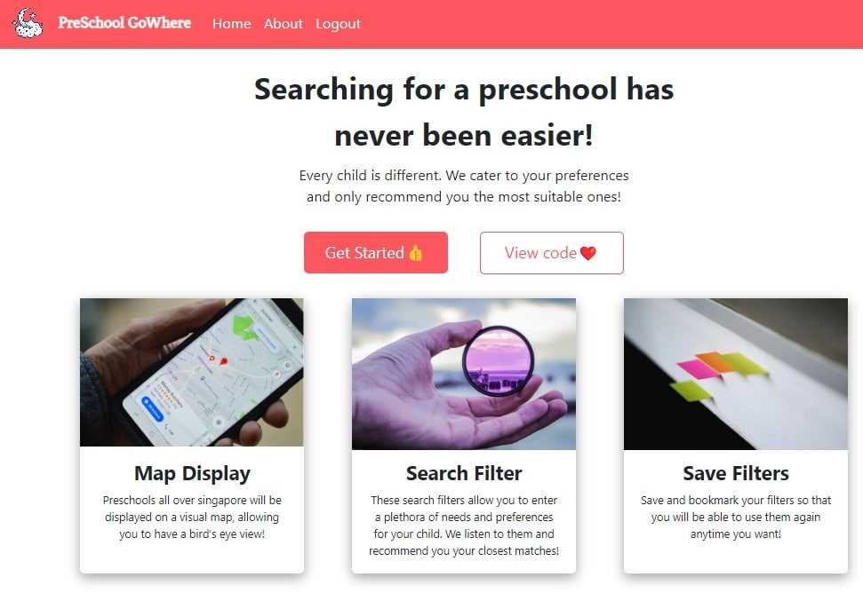
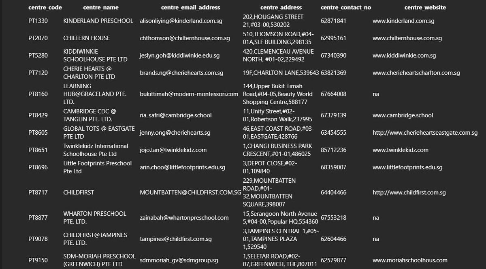
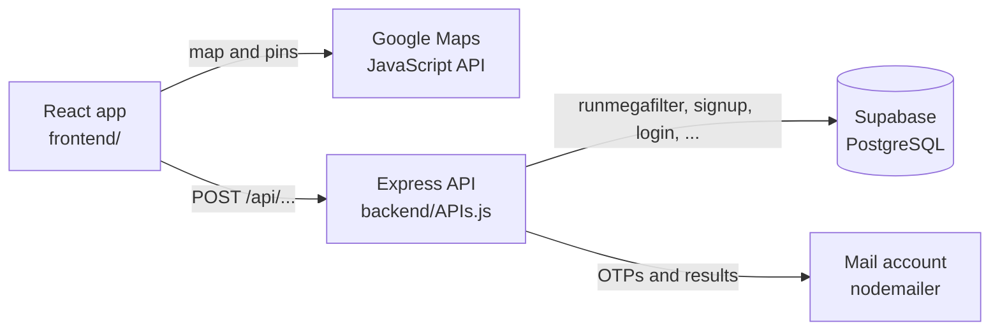

<div align="center">


<h1>PreSchool GoWhere</h1>

<p><strong>Find a preschool in Singapore that fits your child.</strong></p>

<p>A web app for parents. Set criteria such as food policy, second language, fees and distance,<br>
and see the matching preschools on a Google Map. Save the filter for later, or have the results emailed to you.</p>

[](#team) [](#status) [](frontend/package.json) [](backend/APIs.js) [](frontend/src/components/MapsComponents/Map.js) [](https://github.com/xitij27/preschool-gowhere/commits/main)

<p>
  <a href="#what-it-does"><strong>What it does</strong></a>
  &nbsp;&nbsp;|&nbsp;&nbsp;
  <a href="#running-it-locally">Run it locally</a>
  &nbsp;&nbsp;|&nbsp;&nbsp;
  <a href="#api">API</a>
  &nbsp;&nbsp;|&nbsp;&nbsp;
  <a href="docs/Report.pdf">Report (PDF)</a>
  &nbsp;&nbsp;|&nbsp;&nbsp;
  <a href="docs/presentation_slides.pdf">Slides (PDF)</a>
</p>



<sub>Filtering by distance, fees, citizenship, level, service, second language and food, with the matches on the map and one preschool opened.</sub>

</div>

<br>

## What it does

<table>
  <tr>
    <td width="50%" valign="top">
      
      <br><sub>The start page.</sub>
    </td>
    <td width="50%" valign="top">
      
      <br><sub>The results, emailed as a table.</sub>
    </td>
  </tr>
</table>

- **Filter preschools** by food policy, SPARK certification, transport, service type, second language, citizenship (for fees), level, type of service, a fee range, and distance from your location. The options are in [`frontend/src/utilities/criterias.js`](frontend/src/utilities/criterias.js).
- **Map of results:** the matching preschools appear on a Google Map, with details for each one.
- **Accounts:** sign up, log in and reset the password, with a 4-digit one-time password sent by email. The app pages under `/app` need a login.
- **Save a filter** (a bookmark) to your account and load it again later.
- **Email the results** to yourself as a table.

## How it works



The React app sends each request to the Express API, which calls a function
in the team's Supabase (PostgreSQL) project and, for OTPs and emailed
results, sends mail with nodemailer.

## Repository layout

This repository combines the team's three original repositories (Frontend,
Backend and Documentation), with each one's history kept in its own folder.

| Path | Contents |
|------|----------|
| [`frontend/`](frontend/) | React app (Create React App, React Router 6, `@react-google-maps/api`) |
| [`backend/APIs.js`](backend/APIs.js) | Express API that calls Supabase (PostgreSQL) functions and sends email with nodemailer |
| `backend/*.sql`, [`backend/SupaBaseFunctionWriter.py`](backend/SupaBaseFunctionWriter.py) | The `RunFilter` and `RunMegaFilter` PostgreSQL functions. The Python script generates their nested `if` branches |
| [`backend/README.md`](backend/README.md) | Parameters of each database function the API calls |
| `backend/Accounts.js`, `backend/Filters.js`, `backend/TestSupraBase.js` | Earlier stand-alone versions of the account and filter APIs, and a Supabase test script |
| [`docs/`](docs/) | [Final report](docs/Report.pdf), [presentation slides](docs/presentation_slides.pdf), and `finalSubmission.zip` with the lab deliverables (proposal, SRS, test plan, and so on) |

## Running it locally

You need Node.js, a Supabase project, a mail account for sending OTPs, and a
Google Maps JavaScript API key.

> [!WARNING]
> **The database isn't included.** The API reads a `PreSchool` table and calls the Supabase functions `runmegafilter`, `runmegafilteremail`, `signup`, `login`, `updatepassword` and `updatebookmark`. It also reads the `Accounts` table directly. Of these, only the filter functions' SQL is in `backend/`. The rest, along with the table schemas and the preschool data, lived in the team's Supabase project and must be recreated.

**1. Start the backend.**

```bash
cd backend
cp .env.example .env      # then fill in SUPABASE_URL, SUPABASE_ANON_KEY, EMAIL_USER and EMAIL_PASS
npm install
node --env-file=.env APIs.js
```

The API listens on port 3005 unless `PORT` is set.

> [!NOTE]
> `--env-file` needs Node 20.6 or later. On older versions, set the variables in your shell and run `npm start` instead.

**2. Start the frontend.**

```bash
cd frontend
cp .env.example .env.local   # then fill in REACT_APP_GOOGLE_MAPS_API_KEY
npm install
npm start
```

The app opens on <http://localhost:3000> and calls the backend at
`http://localhost:3005`. Set `REACT_APP_SERVER_URL` to use a different address.

## API

All routes are `POST` and served by [`backend/APIs.js`](backend/APIs.js).

| Route | Body | Does |
|-------|------|------|
| `/api/sendOTP` | `email` | Emails a 4-digit OTP |
| `/api/signup` | `email`, `password`, `OTP` | Creates an account if the OTP matches |
| `/api/login` | `email`, `password` | Checks the password |
| `/api/updatepassword` | `email`, `password`, `OTP` | Resets the password if the OTP matches |
| `/api/filter` | filter criteria | Returns the matching preschools |
| `/api/filteremail` | filter criteria and `email` | Returns the matching preschools and emails them as a table |
| `/api/updatebookmark` | `email`, `bookmark` (the filter as JSON) | Saves the filter to the account |
| `/api/getbookmark` | `email` | Returns the saved filter |

## Status

> [!IMPORTANT]
> This is a 2022 coursework prototype. OTPs live in the API's memory, so a restart forgets them.

The original deployments are no longer complete: the backend was on Render,
and that service no longer exists. Run both parts locally to try the app.

## Team

Built for NTU's CZ3002 Advanced Software Engineering course (August–November 2022) by
Andrew, Ryan, Harsh Rao D, Sanskar Malavade and Kshitij Parashar (team leader).

<br>

<div align="center">
<sub><a href="#what-it-does">What it does</a> &nbsp;|&nbsp; <a href="#running-it-locally">Run it locally</a> &nbsp;|&nbsp; <a href="docs/Report.pdf">Report</a> &nbsp;|&nbsp; <a href="docs/presentation_slides.pdf">Slides</a> &nbsp;|&nbsp; <a href="https://github.com/xitij27/preschool-gowhere/issues">Issues</a></sub>
</div>
